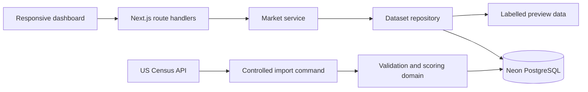

# Architecture

## Overview



The repository is a modular monolith: one Next.js deployment owns the web interface and read API, while PostgreSQL is the durable system of record. This delivers a clean interview-sized system without an unnecessary network boundary between frontend and backend.

## Module boundaries

```text
.
├── docs/                         # architecture, methodology, submission notes
├── drizzle/migrations/           # reviewed PostgreSQL migrations
├── scripts/                      # explicit operational entry points
├── src/
│   ├── app/                      # pages and versioned HTTP route handlers
│   ├── features/market-finder/   # dashboard components and presentation helpers
│   └── server/
│       ├── data/                 # labelled local preview only
│       ├── db/                   # Drizzle schema and connection
│       ├── domain/               # pure types, methodology, and scoring
│       ├── imports/census/       # retrieval, normalization, validation, persistence
│       ├── repositories/         # dataset persistence boundary
│       └── services/             # filtering, sorting, paging, summaries
└── tests/                        # shared setup and browser journeys
```

Dependencies point inward: UI and HTTP handlers call services; services call repositories and pure domain logic; domain modules know nothing about React, Next.js, or PostgreSQL. This keeps scoring unit-testable and makes a future storage change localized.

## Runtime flows

### Read request

1. A route handler validates query parameters with Zod.
2. The market service loads the current dataset through the repository.
3. The service filters, sorts, and paginates while preserving precomputed national rank.
4. The handler returns a typed JSON representation with cache headers.
5. The dashboard renders a table, chart, KPIs, and an explainability drawer.

### Annual data refresh

1. `pnpm data:import` requires explicit Census and database credentials.
2. State and county subject-table rows are retrieved from the Census API.
3. Normalization converts Census sentinel values to missing data and retains estimates and margins of error.
4. Validation requires 51 state-level areas, at least 3,100 counties, and unique GEOIDs.
5. The pure scoring module computes independent state and county percentiles and ranks.
6. Batched upserts persist areas, metrics, rankings, and a checksummed import audit record.
7. Production reads use only the latest completed import, so a failed import cannot replace the visible dataset.

## Data model

- `areas`: stable geographic identity and state relationship.
- `market_metrics`: source estimates by area and ACS vintage.
- `area_rankings`: derived percentiles, score, quality, rank, and methodology version.
- `data_imports`: source URLs, checksum, status, counts, timestamps, and failure summary.

Raw facts and derived rankings are separate. A methodology change can create a new ranking version without overwriting source metrics.

## Deliberate constraints

- No authentication: the assignment is a public read-only demo.
- No separate backend service: route handlers are sufficient for the read workload.
- No Redis or queue: the controlled annual import is not request-driven.
- No live Census calls from the UI: serving stored data is faster, reproducible, and resilient.
- No per-filter reranking: ranks remain nationally meaningful.
